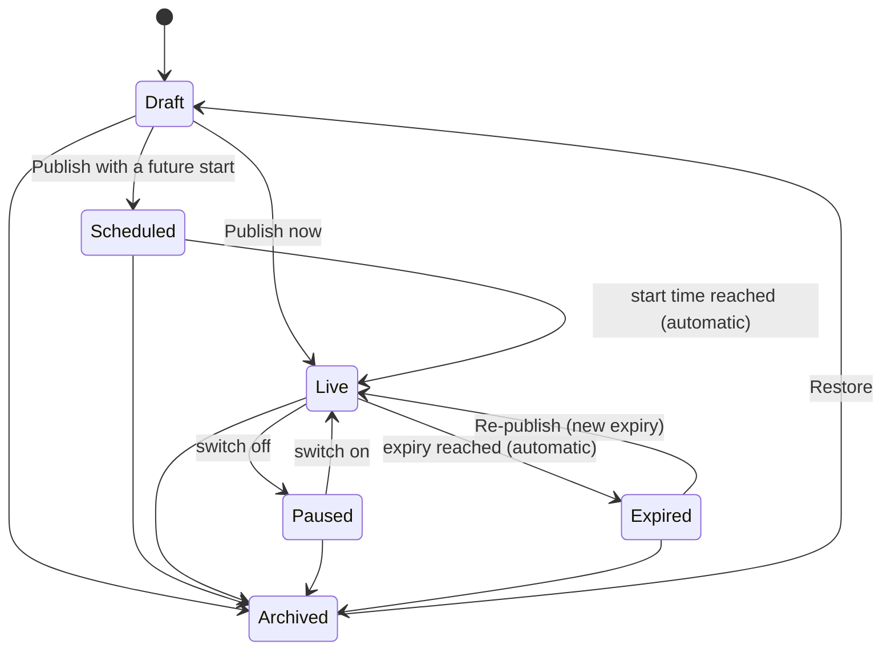

# Alert Center & Homepage Pop-Ups — Setup, Lifecycle, Workflow and Permissions

The **Alert Center** (`alert.html`, opened from Admin Hub → *Alert Center*) manages every ACNHS announcement from one page:

* **Homepage pop-ups** — shown automatically to anyone who visits https://www.acnhs.am/, even if they are not signed in.
* **Student-portal alerts** — the existing portal alerts (modal / banner / toast), all preserved.
* Groups, individual students, priorities, schedules, templates and analytics.

---

## 1. One-time setup (3 steps)

1. **Upgrade the database** — open the Supabase SQL Editor (project `eyhksbiceueoiamwnqpr`), paste the contents of
   [`ADD-HOMEPAGE-POPUP-ALERTS.sql`](ADD-HOMEPAGE-POPUP-ALERTS.sql) and click **Run**.
   * Safe to run more than once. Purely additive: every existing alert keeps working (they become *Student portal* alerts).
   * Until it has been run, the Alert Center shows a yellow *"database upgrade needed"* banner and only student-portal alerts can be created. The homepage simply shows nothing (no errors).
2. **Deploy the site files** — `alert.html`, `css/alert-admin.css`, `js/alert-admin-*.js`, `js/homepage-alerts.js`, `js/alerts.js`, `index.html`, `hub.html`, `admin-users.html`, `admin-hub.html`.
   Deploy them **after** step 1.
3. **Give other staff access (optional)** — Admin Users → edit a user → *Announcements & Alerts*:
   * **Manage Alerts** (`manage_alerts`) — editor
   * **Publish Alerts** (`publish_alerts`) — publisher

The main administrator (`hrachfilm@gmail.com`) always has full access. `supabase/schema.sql` already contains the consolidated schema.

### Verify

```sql
select column_name from information_schema.columns
where table_name = 'portal_alerts' and column_name in ('display_surface','lifecycle_status','priority','publish_at','expires_at','popup_frequency');
select public.get_site_alerts('homepage');   -- returns {"server_time": ..., "alerts": [...]}
```

---

## 2. Alert lifecycle and statuses

Stored: `lifecycle_status` (`draft` / `published` / `archived`) + `is_active` (the instant on/off switch) + `publish_at` / `expires_at`.
Shown on the dashboard: one **derived status**, evaluated with the current time (Armenia time, UTC+4).

| Status | Meaning | Visible to the audience? |
|---|---|---|
| **Draft** | Being written; never published (or restored from the archive). | No |
| **Scheduled** | Published, but the start time is in the future. Goes live automatically. | Not yet |
| **Live** | Published, switched on, inside its start / expiry window. | **Yes** |
| **Paused** | Published but switched off (instant disable). Can be resumed at any time. | No |
| **Expired** | Its expiry time has passed. Can be re-published with a new expiry. | No |
| **Archived** | Retired and kept for the record. Can be restored as a draft. | No |

Order of evaluation: *archived → draft → paused → scheduled → expired → live*.



Database rules (enforced by the `portal_alerts_v2_guard` trigger, so they hold even for direct database writes):

* Drafts and archived alerts are always switched off — no delivery engine can show them.
* `expires_at` must be later than `publish_at`.
* The message may not contain scripts, frames, styles or event handlers; the button link must be `https://`, `http://`, `mailto:`, `tel:` or a relative page (never `javascript:`).
* `revision` increases whenever visitor-visible content changes (title, message, button, priority, acknowledgement). It does **not** change on pause / resume, schedule or audience edits.

---

## 3. Administrator workflow

1. **Create** — *New announcement*. Write title + message (rich text), optionally add an action button and link.
2. **Choose placement** — Homepage pop-up, Student portal, or both.
3. **Choose audience** — Everyone · Visitors only (not signed in) · Signed-in students · Selected groups · Specific students.
4. **Priority & behaviour** — Normal / Important / Urgent / Critical; closable or *must acknowledge*; homepage frequency (*every visit*, *once per session*, *once per visitor until updated*).
5. **Schedule** — start immediately or at a date/time; optional automatic expiry; optional "only on certain days" pattern.
6. **Preview** — the right-hand panel renders the **real** homepage pop-up (desktop / phone, visitor / student). *Test on the real homepage* opens `index.html?acnhs_alert_preview=<id>` as an administrator (nothing is recorded, visitors are unaffected).
7. **Save draft** or **Publish now / Schedule**. Publishing to the homepage asks for confirmation with a plain-language summary ("What will happen").
8. **Operate** — from the dashboard: switch on/off instantly, edit, duplicate, re-show to everyone, archive, restore, delete. Categories: All · Homepage pop-ups · Student portal · Group-specific · Urgent · Scheduled · Expired & archived · Templates · Analytics. Search, filter (status / placement / priority / audience) and sort are available everywhere.

### Permission matrix

| Action | Main administrator | Publisher (`publish_alerts`) | Editor (`manage_alerts`) |
|---|:--:|:--:|:--:|
| Open Alert Center, view alerts, analytics, templates | ✓ | ✓ | ✓ |
| Create / edit drafts, duplicate, preview, save templates | ✓ | ✓ | ✓ |
| Pause (switch off), archive, restore | ✓ | ✓ | ✓ |
| Publish, schedule, switch **on**, publish drafts | ✓ | ✓ | – |
| Edit **live or scheduled** alerts | ✓ | ✓ | – |
| Re-show to everyone | ✓ | ✓ | – |
| Delete permanently | ✓ | ✓ | – |

Accounts without either permission see an *Access restricted* page. Anyone not signed in as an administrator is sent to the login page.

---

## 4. How delivery works

### Homepage (`js/homepage-alerts.js`, loaded by `index.html`)

* Runs **after the page has loaded and the browser is idle**, then makes **one** small request (`rpc/get_site_alerts`). No Supabase library, no layout shift, never blocks rendering. The list is cached for 20 s per session; if the feature is not installed it is not retried for 5 min.
* The database decides *which alerts are currently live* using **its own clock** (`publish_at`, `expires_at`, published, switched on). Changes and deactivations therefore apply immediately for the next page view (existing visitors within ~20 s).
* The browser then applies audience, frequency and acknowledgement rules.
* **Queue**: several live alerts appear as one organised pop-up ("1 of 3"), highest priority first, at most **3 per visit**. Urgent / critical alerts show without the initial delay; normal alerts wait for the page to settle and for the cookie banner to be answered (up to 8 s).
* **Frequency**: *every visit* · *once per session* (browser session) · *once per visitor* (stored in the browser until the alert's `revision` changes or you use **Re-show to everyone**). *Must acknowledge* alerts are only marked as seen once the visitor presses the acknowledge button.
* **Students**: recognised as signed in when the portal session in the same browser says so (`isLoggedIn`, a student record, not an admin / applicant). Group alerts match the student's `group`, `group_name` or `program` against the selected groups. Student views are recorded (visible under *Analytics*); anonymous visitors are not tracked.
* **Safety**: message HTML passes a strict allow-list sanitizer (paragraphs, bold/italic/underline, lists, safe links); every failure is swallowed so a database or network problem never affects the page.
* **Search engines**: crawlers and speed-test robots (Googlebot, Bingbot, Lighthouse, PageSpeed …) never receive pop-ups, so the indexed page stays clean. Google can penalise full-screen pop-ups that cover a page immediately for mobile visitors arriving from search, so prefer *once per session / once per visitor* and keep wording short; reserve *Urgent / Critical + must acknowledge* for real notices.

### Student portal (`js/alerts.js`)

Unchanged behaviour, plus: homepage-only, draft, archived, not-yet-started and expired alerts are ignored; alerts are ordered most important first; *must acknowledge* hides the close button; the action link honours "open in new tab". `hub.html` notifications/announcements apply the same filters.

---

## 5. Security model (please read)

The ACNHS admin area signs in **in the browser** (session flags set after the password check) and the website talks to Supabase with the public `anon` key. This is how every admin page works today, and it limits what any single feature can guarantee:

* The Alert Center page blocks non-admins and enforces the permission matrix **in the interface**. Someone who bypasses the page and calls the database directly with the public key is limited only by the database rules above (content safety, link allow-list, lifecycle invariants), not by identity.
* Row-level security for `portal_alerts` remains open to `anon` (as before) because the admin page itself uses that role. Student-targeted alert text is therefore not confidential.

Recommended hardening (separate project): move administrator sign-in to Supabase Auth (or an Edge Function that verifies the admin), then change the `portal_alerts` write policies to `authenticated` + admin check and keep only `get_site_alerts` public. The delivery function was designed so that this change will not require touching the homepage script.

---

## 6. Troubleshooting

| Symptom | Check |
|---|---|
| Nothing appears on the homepage | Is the alert **Live** (not Draft / Paused / Scheduled / Expired)? Placement includes *Homepage*? Did you run the SQL? In a browser console on the homepage run `ACNHSHomepageAlerts.debug()` — it prints, per alert, why it is or is not shown. Add `?acnhs_alert_debug=1` to the URL for a detailed log. |
| Visitor already saw it | Frequency flags live in the browser. Run `ACNHSHomepageAlerts.reset()` in the console, use a private window, or press **Re-show to everyone**. |
| Student-only alert not visible | The student must be signed in in that browser; group alerts need a matching `group` / `group_name` / `program`. |
| Pop-up waits a few seconds | It waits for the cookie banner to be answered (up to 8 s) unless the alert is Urgent / Critical. |
| "Database upgrade needed" banner | Run `ADD-HOMEPAGE-POPUP-ALERTS.sql`, then *I ran it – check again*. If it still shows after a successful run, execute `NOTIFY pgrst, 'reload schema';` in the SQL Editor (refreshes Supabase's API cache) and reload the page. |
| Saving fails with "markup that is not allowed" | Remove pasted scripts / embeds; use the formatting toolbar instead. |

## 7. Rollback (only if ever needed)

```sql
drop trigger if exists portal_alerts_v2_guard_trg on public.portal_alerts;
drop function if exists public.portal_alerts_v2_guard();
drop function if exists public.get_site_alerts(text);
-- Columns are additive and harmless; keep them. Old alerts continue to work.
```

## 8. Files

| File | Purpose |
|---|---|
| `ADD-HOMEPAGE-POPUP-ALERTS.sql` | Idempotent migration (columns, constraints, guard trigger, delivery function) |
| `supabase/schema.sql` | Master schema (consolidated alert section appended) |
| `alert.html`, `css/alert-admin.css`, `js/alert-admin-{core,list,composer,extras}.js` | Alert Center |
| `js/homepage-alerts.js` | Public homepage pop-up engine + shared preview renderer |
| `js/alerts.js`, `hub.html` | Student-portal delivery (compatible updates) |
| `index.html` | Loads the homepage engine |
| `admin-users.html`, `admin-hub.html` | New permissions; link renamed to *Alert Center* |
